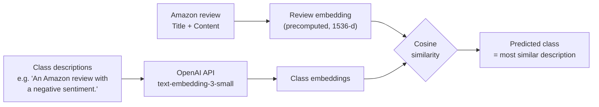
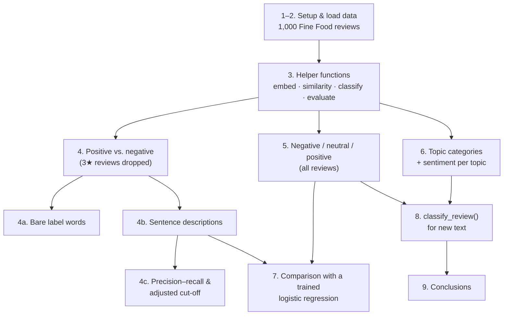
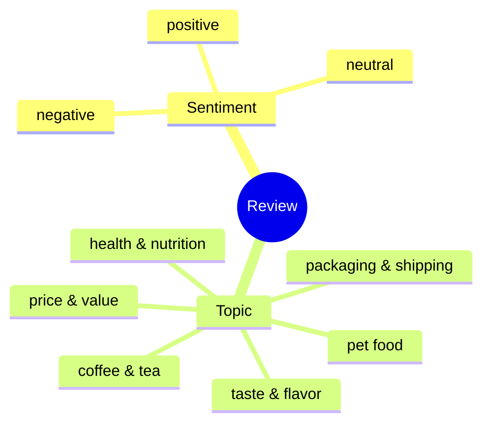
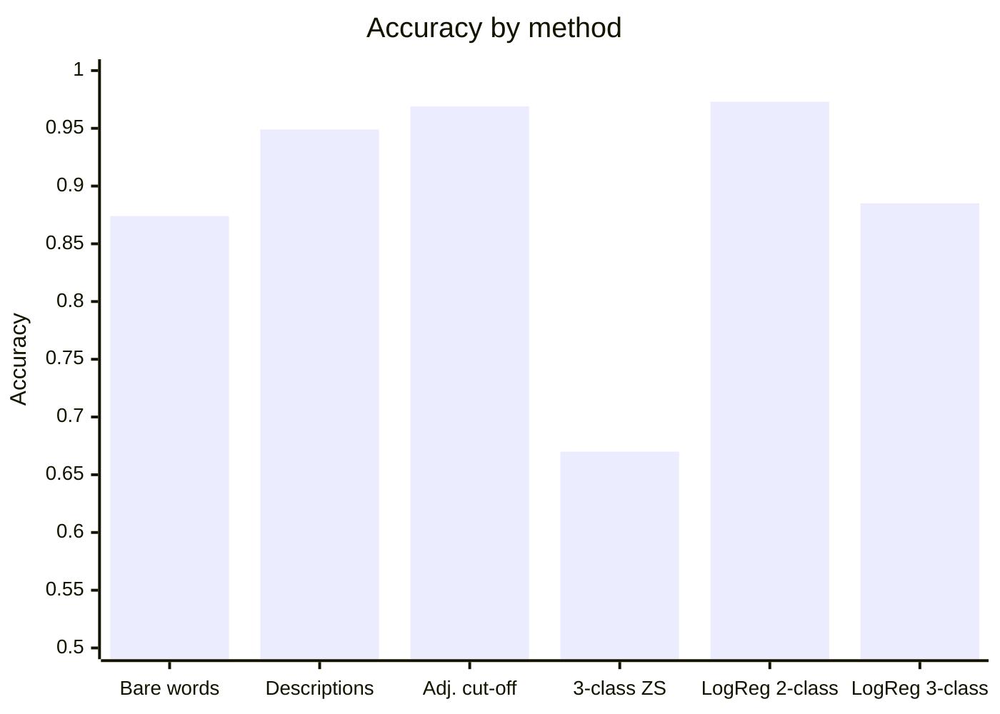
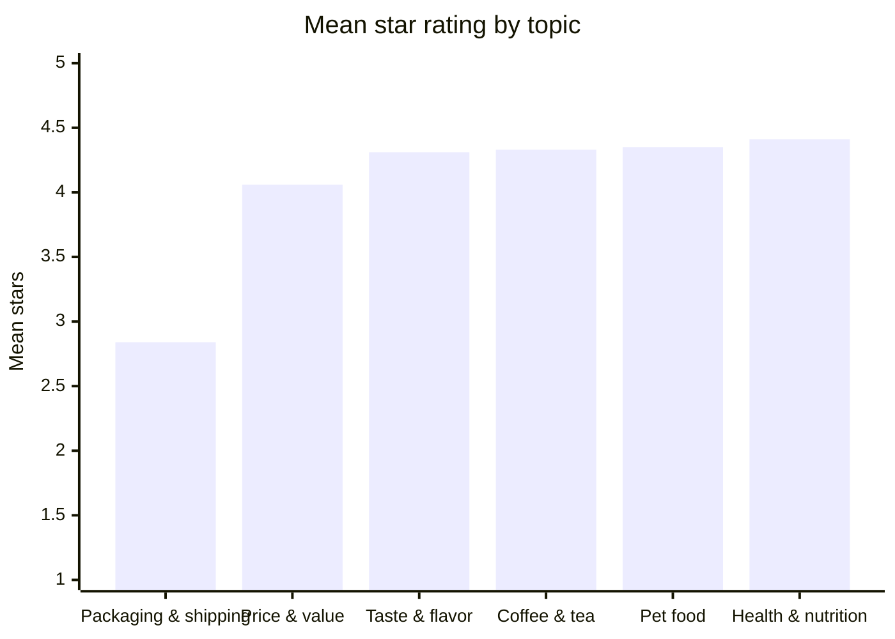

# Zero-Shot Classification of Amazon Reviews with OpenAI Embeddings

This project sorts Amazon product reviews into sentiment and topic classes **without any labeled training data**. It uses OpenAI embeddings and cosine similarity, following the OpenAI Cookbook example [*Zero-shot classification with embeddings*](https://developers.openai.com/cookbook/examples/zero-shot_classification_with_embeddings).

Everything lives in one notebook: [`amazon_reviews_zero_shot_classification.ipynb`](amazon_reviews_zero_shot_classification.ipynb).

## How it works

Each class is defined only by a short sentence, such as *"An Amazon review with a negative sentiment."* The notebook embeds every review and every class description with the same model. Each review is then assigned to the class whose description is most similar.



The review embeddings in the dataset were made with `text-embedding-3-small`, so the class descriptions must be embedded with the same model. Otherwise the two sets of vectors can't be compared.

## Notebook walkthrough



| Section | What it does |
|---|---|
| 2. Load data | Downloads the cookbook's 1,000 Amazon Fine Food reviews, which include precomputed embeddings. Maps stars to sentiment: 1–2 → negative, 3 → neutral, 4–5 → positive. |
| 4. Positive vs. negative | Compares bare label words with sentence-style descriptions. Plots a precision–recall curve and adjusts the decision cut-off for the imbalanced data (about 85% positive). |
| 5. Three classes | Adds the 3-star reviews back in as a neutral class. |
| 6. Topics | Assigns each review to one of six topics and shows the sentiment mix per topic. Topics have no ground truth, so this part is exploratory. |
| 7. Trained baseline | Logistic regression on the same embeddings (80/20 split), to show how close zero-shot gets to a model that learns from labels. |
| 8. New reviews | `classify_review(text)` returns sentiment and topic, with similarity scores, for any review text. |

### Classes



## Results

| Task | Method | Accuracy | Macro-F1 |
|---|---|---|---|
| Positive vs. negative | Bare label words | 0.874 | 0.801 |
| Positive vs. negative | Sentence descriptions | 0.949 | 0.909 |
| Positive vs. negative | Descriptions + adjusted cut-off* | 0.969 | 0.932 |
| Negative / neutral / positive | Sentence descriptions | 0.670 | 0.607 |
| Positive vs. negative | Logistic regression (trained)† | 0.973 | 0.950 |
| Negative / neutral / positive | Logistic regression (trained)† | 0.885 | 0.749 |

\* The cut-off was picked on the same reviews it was scored on, so this number is somewhat optimistic.
† Scored on a 20% held-out sample; the zero-shot rows use all reviews.



**Average star rating by topic.** Packaging and shipping is the clear pain point.



### Takeaways

- **Label wording matters.** Describing each class in a full sentence that resembles the data improved accuracy by about 7.5 points over bare words.
- **Adjust the cut-off on imbalanced data.** Using `sim(positive) − sim(negative)` as a score and moving the cut-off improves results for the minority negative class.
- **Neutral is the weak spot.** The zero-shot model calls too many reviews neutral: it finds 76% of real 3-star reviews, but only 17% of reviews it labels neutral actually are.
- **Topics explain the *why*.** Packaging and shipping reviews average 2.8★, compared with 4.1–4.4★ for every other topic.
- **If you have labels, use them.** Logistic regression on the same embeddings is clearly better, especially for three classes. Zero-shot is best for getting started quickly, for new categories, or when no labeled data exists.

## Setup

1. Install the dependencies:

   ```bash
   pip install openai python-dotenv pandas numpy scikit-learn matplotlib jupyter
   ```

2. Create a `.env` file from the template and add your OpenAI API key:

   ```bash
   cp env.sample .env
   ```

3. Open the notebook and run all cells:

   ```bash
   jupyter notebook amazon_reviews_zero_shot_classification.ipynb
   ```

On the first run the dataset is downloaded to `data/`. API calls are only needed for the class descriptions and the sample new reviews, so a full run costs a fraction of a cent.

## Project files

```
.
├── README.md
├── amazon_reviews_zero_shot_classification.ipynb   # main notebook (with saved outputs)
├── env.sample                                      # template for .env
├── .env                                            # your OPENAI_API_KEY (keep private)
└── data/
    └── fine_food_reviews_with_embeddings_1k.csv    # downloaded on first run
```

## References

- OpenAI Cookbook: [Zero-shot classification with embeddings](https://developers.openai.com/cookbook/examples/zero-shot_classification_with_embeddings)
- Dataset: [Amazon Fine Food Reviews](https://www.kaggle.com/snap/amazon-fine-food-reviews), 1,000-review sample with embeddings from the [OpenAI Cookbook repository](https://github.com/openai/openai-cookbook/tree/main/examples/data)
